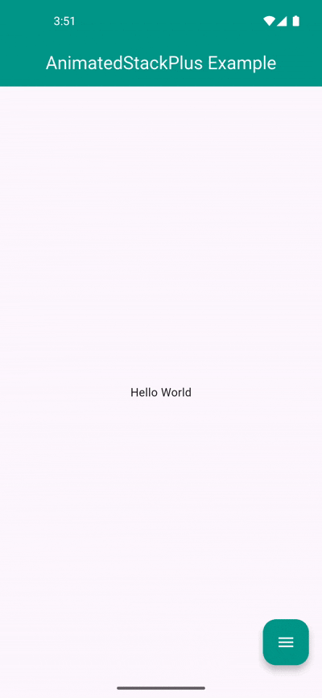
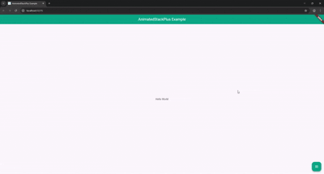

# animated_stack_plus

[](https://pub.dev/packages/animated_stack_plus)
[](https://pub.dev/packages/animated_stack_plus/score)




A flexible and modern **animated Floating Action Button (FAB) stack menu** for Flutter — inspired by the original [`animated_stack`](https://pub.dev/packages/animated_stack), but fully rebuilt with customizable builders, animations, and interaction handling.

---

## Features

- Beautiful **FAB-based sliding stack**
- Customizable **top (column)** and **bottom (row)** action layouts
- Easy `closeFab()` callback passed to all actions
- Separate **open/close FAB widgets** (not just IconData)
- Fully configurable **animation duration**, **curves**, and **background colors**
- Safe foreground interaction with optional **fading dim overlay**
- **Click outside to dismiss** the FAB menu
- **Native SnackBar support** (entire menu shifts together in unison with Scaffold layout shifts)
- Works on **mobile**, **tablet**, and **web**
- Modern Flutter compatibility (Dart 3.x with updated SDK parameters)

---

## 🧩 Getting Started

### Installation

Add to your `pubspec.yaml`:
```yaml
dependencies:
  animated_stack_plus: ^1.1.0
```

Then run:
```bash
flutter pub get
```

Import it:
```dart
import 'package:animated_stack_plus/animated_stack_plus.dart';
```

---

## 💡 Usage Example

Here’s a complete working example:

```dart
import 'package:animated_stack_plus/animated_stack_plus.dart';
import 'package:flutter/material.dart';

void main() {
  runApp(const ExampleApp());
}

class ExampleApp extends StatelessWidget {
  const ExampleApp({super.key});

  @override
  Widget build(BuildContext context) {
    final GlobalKey<ScaffoldMessengerState> scaffoldMessengerKey =
        GlobalKey<ScaffoldMessengerState>();

    return MaterialApp(
      scaffoldMessengerKey: scaffoldMessengerKey,
      title: 'AnimatedStackPlus Example',
      debugShowCheckedModeBanner: false,
      home: AnimatedStack(
        backgroundColor: Colors.grey[200]!,
        fabBackgroundColor: Colors.teal,
        // Accept generic widgets instead of icons
        fabOpenWidget: const Icon(Icons.menu, color: Colors.white),
        fabCloseWidget: const Icon(Icons.close, color: Colors.white),
        scaleWidth: 60,
        scaleHeight: 60, // Height expanded to accommodate vertical action button height

        // Column of buttons (top stack)
        columnWidgetBuilder: (closeFab) => Column(
          spacing: 20,
          children: [
            IconButton(
              style: IconButton.styleFrom(backgroundColor: Colors.pink),
              onPressed: () {
                closeFab();
                scaffoldMessengerKey.currentState?.showSnackBar(
                  const SnackBar(content: Text('Share button pressed')),
                );
              },
              icon: const Icon(Icons.share, color: Colors.white),
            ),
            IconButton(
              style: IconButton.styleFrom(backgroundColor: Colors.blue),
              onPressed: () {
                closeFab();
                scaffoldMessengerKey.currentState?.showSnackBar(
                  const SnackBar(content: Text('Contact button pressed')),
                );
              },
              icon: const Icon(Icons.call, color: Colors.white),
            ),
          ],
        ),

        // Row of buttons (bottom stack)
        bottomWidgetBuilder: (closeFab) => Row(
          children: [
            IconButton(
              style: IconButton.styleFrom(backgroundColor: Colors.orange),
              onPressed: () {
                closeFab();
                scaffoldMessengerKey.currentState?.showSnackBar(
                  const SnackBar(content: Text('Message button pressed')),
                );
              },
              icon: const Icon(Icons.message, color: Colors.white),
            ),
          ],
        ),

        // Foreground main screen
        foregroundWidget: Scaffold(
          appBar: AppBar(
            title: const Text('AnimatedStackPlus Example',
                style: TextStyle(color: Colors.white)),
            backgroundColor: Colors.teal,
            centerTitle: true,
          ),
          body: const Center(child: Text('Hello World')),
        ),
      ),
    );
  }
}
```

---

## ⚙️ Parameters

| Name                            | Type                                     | Description                                          | Default |
|---------------------------------|------------------------------------------|------------------------------------------------------|---------|
| `foregroundWidget`              | `Widget`                                 | Main content shown under the FAB stack               | Required |
| `columnWidgetBuilder`           | `Widget Function(VoidCallback closeFab)` | Builder for vertical (top) actions                   | Required |
| `bottomWidgetBuilder`           | `Widget Function(VoidCallback closeFab)` | Builder for horizontal (bottom) actions              | Required |
| `backgroundColor`               | `Color`                                  | The background canvas color behind the sliding UI    | Required |
| `fabBackgroundColor`            | `Color`                                  | FAB background color                                 | Required |
| `fabOpenWidget`                 | `Widget`                                 | Custom widget shown inside FAB when the menu is closed | Required |
| `fabCloseWidget`                | `Widget`                                 | Custom widget shown inside FAB when the menu is open   | Required |
| `scaleWidth` / `scaleHeight`    | `double`                                 | How much the foreground slides when FAB opens        | `60` / `60` |
| `fabSize`                       | `double`                                 | The width and height of the Floating Action Button   | `56.0` |
| `actionsSpacing`                | `double`                                 | Spacing separation between FAB and action buttons   | `16.0` |
| `foregroundDimColor`            | `Color`                                  | Optional color overlay to dim foreground UI on open   | `Colors.transparent` |
| `slideAnimationDuration`        | `Duration`                               | Duration of the slide animation                      | `Duration(milliseconds: 800)` |
| `openAnimationCurve`            | `Curve`                                  | Curve when opening the FAB stack                     | `Curves.easeOut` |
| `closeAnimationCurve`           | `Curve`                                  | Curve when closing the FAB stack                     | `Curves.easeInToLinear` |
| `enableClickToDismiss`          | `bool`                                   | Whether tapping outside closes the menu              | `true` |
| `preventForegroundInteractions` | `bool`                                   | Prevents UI below the FAB from interaction when open | `true` |
| `onForegroundCallback`          | `VoidCallback?`                          | Called when the FAB stack closes                     | `null` |

---

## 🧠 Inspired By

This package is based on the original [`animated_stack`](https://pub.dev/packages/animated_stack) by **Emadeddin Eibo**, but rebuilt with:
- Builder-based architecture for dynamic UI
- Standard Material FAB transitions and SnackBar alignment support
- Optimized rendering pipeline decoupled from redundant MediaQuery updates
- Full control over widgets, spacing, animations, and custom layout overlays

---

## 📜 License
MIT License

---

## 🤝 Contributions Welcome

Found a bug or want to improve this widget?  
Open an issue or pull request on GitHub:

👉 [github.com/hbsgujjar111/animated_stack_plus](https://github.com/hbsgujjar111/animated_stack_plus)
